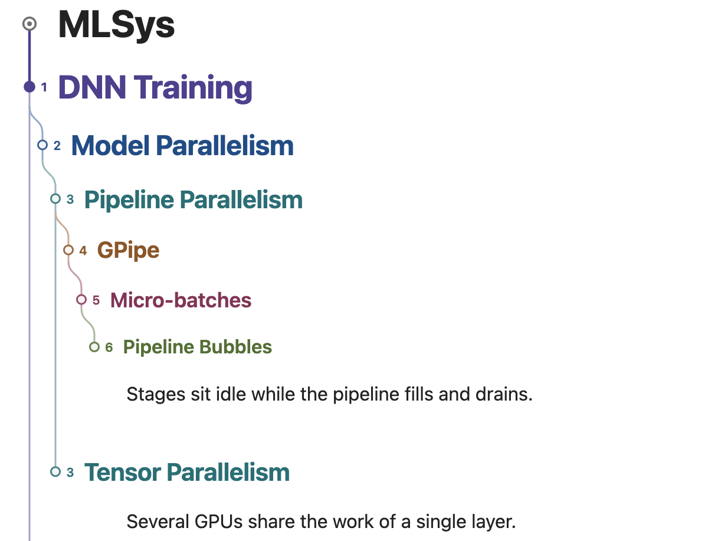

# Obsidian Git Branch Editor

An Obsidian plugin that connects headings with Git-style branch lines. Each of the six heading levels has its own color. Click a node to fold or expand its section in the editor or Reading view.

## Install

1. In your vault, create `.obsidian/plugins/git-branch-editor/`.
2. Copy [main.js](main.js), [manifest.json](manifest.json), and [styles.css](styles.css) into that folder.
3. Reload Obsidian (1.12 or later), then enable **Git Branch Editor** under **Settings → Community plugins**.
